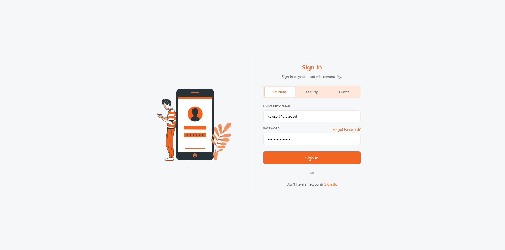
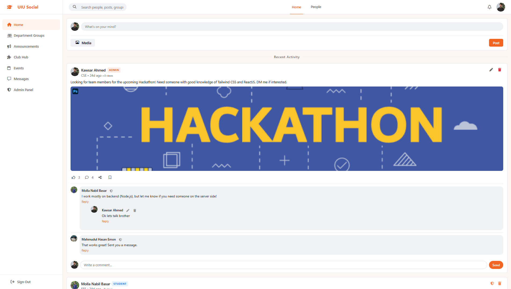
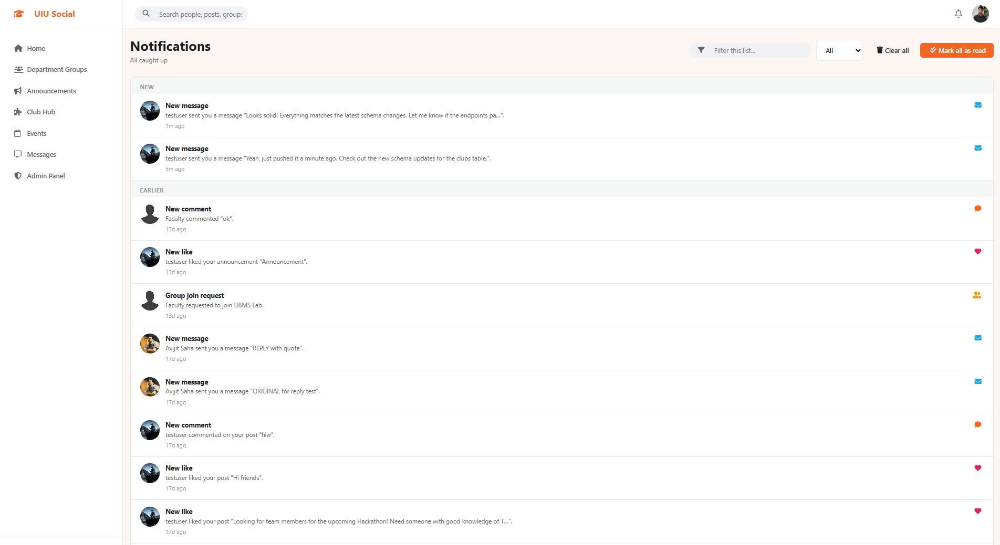
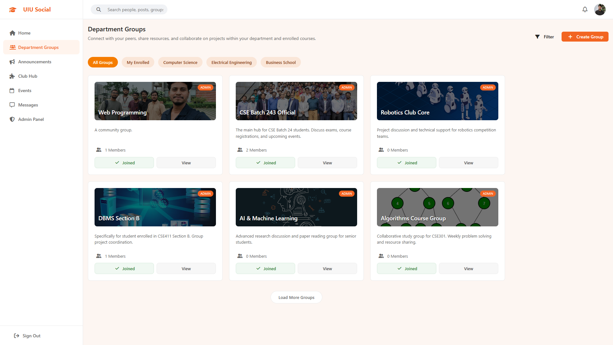
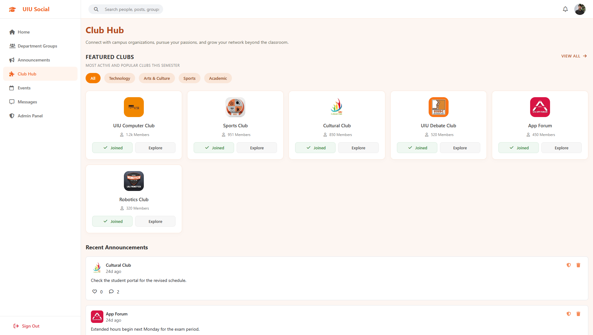
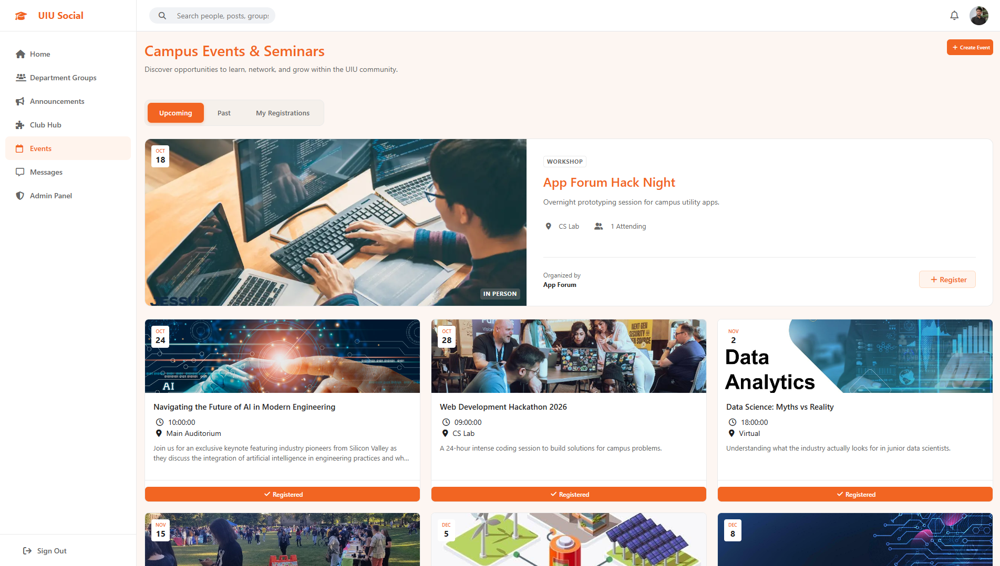
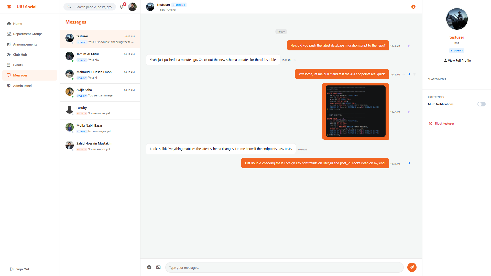
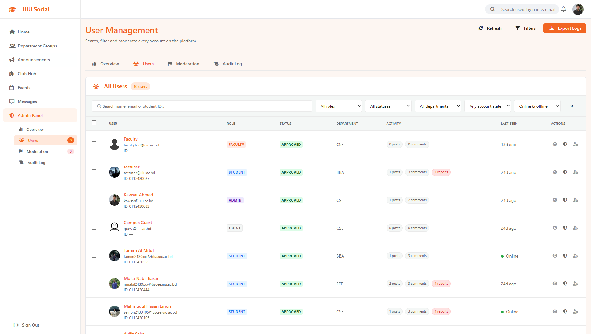
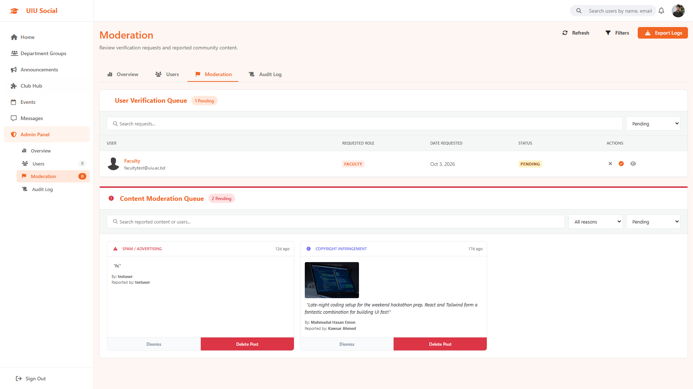
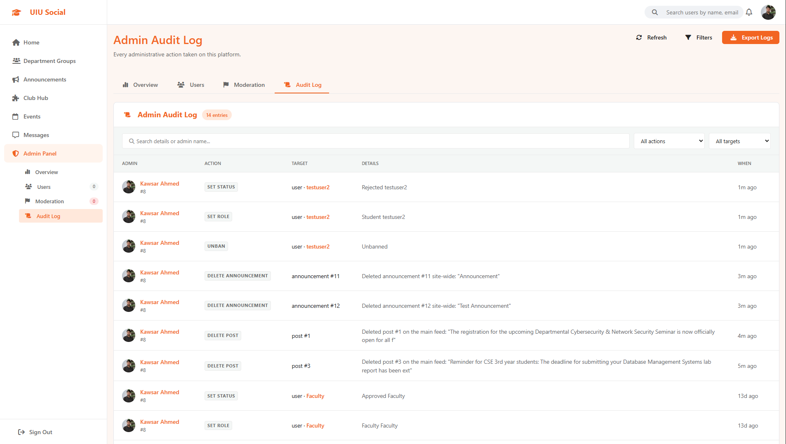

# UIU Social

A campus social networking platform for United International University built with PHP, vanilla JavaScript, and MySQL.

## Table of Contents

- [About](#about)
- [Features](#features)
- [Screenshots](#screenshots)
- [Technology Stack](#technology-stack)
- [Database](#database)
- [Installation](#installation)
- [Configuration](#configuration)
- [API Reference](#api-reference)

## About

UIU Social is a campus social networking platform that enables students and faculty to connect, share posts, join groups and clubs, attend events, send private messages, and receive announcements and notifications.

The application is a plain PHP backend with a vanilla JavaScript frontend and a MySQL database. It uses no frontend framework and no PHP framework. Pages are standard HTML with JavaScript calling a JSON API for dynamic behavior.

## Features

### Authentication and accounts

- Login, registration, password reset, and logout
- Role based access control for student, faculty, guest, and admin users
- Account approval workflow where new registrations are pending until an admin approves them
- Registration restricted to the uiu.ac.bd email domain
- Guest access available without registration

### Profiles

- User profiles with avatar, cover photo, department, about text, and online status
- Profile editing with image upload and URL input
- Role badges indicating student or faculty status

### Feed and posts

- Activity feed with text and image posts
- Likes, comments, and nested comment replies
- Post editing, deletion, sharing, and saving
- View counts and edited markers on posts
- Filtering posts by keyword and by user

### Connections and people

- Connection requests between users with accept, reject, cancel, and remove actions
- People directory with connection status indicators
- Follow and follower relationships

### Groups

- Department and interest groups with creation, membership, joining, and leaving
- Group admin promotion and member removal
- Group posts restricted to members

### Clubs

- Club hub with club listings and club detail pages
- Club membership with roles including owner, admin, member, and requested
- Club posts, comments, and likes
- Club announcements and club events
- Club tags and activities

### Events

- Campus and club events with date, time, location, and type
- RSVP tracking with attendee counts
- Featured events

### Announcements

- Campus and club announcements with likes and comments
- Announcement listing and detail views

### Messaging

- Real time one on one messaging using Server Sent Events
- Conversations list and message threads
- Message attachments with MIME type validation for images, PDFs, documents, and archives
- Read receipts and message replies
- Blocking and unblocking users in chat

### Notifications and moderation

- Notifications center with unread badge and mark all as read
- Post reporting with categories including spam, harassment, copyright, hate speech, and misinformation
- Moderation queue for reported content
- Admin panel with statistics, user management, ban controls, report handling, join request handling, content deletion, and admin logs

### Interface

- Responsive sidebar navigation with mobile menu
- Global search across people, posts, groups, clubs, and events with Ctrl K shortcut
- Search results page
- User settings for message privacy, post privacy, email notifications, and push notifications
- Toast notifications and modal dialogs
- Hash based navigation to posts and comments

## Screenshots

### 1. Authentication & Onboarding
| Sign In Page |
| :---: |
|  |

---

### 2. Feeds & Notifications
| Main Activity Feed |
| :---: |
|  |

| Notifications Center |
| :---: |
|  |

---

### 3. Communities & Events
| Department Groups |
| :---: |
|  |

| Club Hub |
| :---: |
|  |

| Campus Events & Seminars |
| :---: |
|  |

---

### 4. Real-time Messaging
| One-on-One Chat Thread |
| :---: |
|  |

---

### 5. Administration & Moderation
| User Management |
| :---: |
|  |

| Content Moderation Queue |
| :---: |
|  |

| Admin Audit Log |
| :---: |
|  |
## Technology Stack

| Layer | Technology |
|-------|------------|
| Backend | PHP 7.4 or newer with PDO MySQL extension |
| Frontend | HTML5, CSS3, vanilla JavaScript ES6 |
| Icons | Font Awesome 6 via CDN |
| Database | MySQL |
| Web server | Apache or nginx with PHP |
| Real time chat | Server Sent Events at api/messages/stream.php |

## Database

database/uiusocial.sql creates the uiusocial database and seeds it with sample data. Run this file first to initialize the project.

database/migrate.php adds or updates tables and columns for existing installations. It is safe to run on an already initialized database.

### Core tables

| Table | Purpose |
|-------|---------|
| users | Accounts with name, email, student id, department, role, avatar, status, online flag, and ban fields |
| posts | Feed posts with content, image, group association, and edit and share tracking |
| post_likes | Post like records |
| comments | Post comments with a parent id for nested replies |
| reports | User reports on posts |
| clubs | Campus clubs with category, image, icon, cover color, founder, and about text |
| club_tags | Tags for clubs |
| club_activities | Activities for clubs |
| club_posts | Posts inside clubs |
| club_post_likes | Likes on club posts |
| club_post_comments | Comments on club posts |
| club_members | Club membership with roles |
| groups_table | Department and interest groups |
| group_members | Group membership |
| events | Campus and club events with date, time, location, type, and RSVP tracking |
| event_rsvps | Event attendance records |
| messages | One on one private messages with attachments and read status |
| blocked_users | Blocked user pairs in chat |
| verification_queue | Pending account approval requests |
| moderation_queue | Reported content awaiting review |
| connections | User connection requests |
| announcements | Campus and club announcements |
| announcement_likes | Likes on announcements |
| announcement_comments | Comments on announcements |
| notifications | User notifications with read status |
| password_resets | Password reset tokens |
| post_saves | Saved or bookmarked posts |
| comment_likes | Likes on comments |
| follows | Follow relationships |
| user_settings | Per user privacy and notification preferences |
| admin_logs | Audit log of admin actions |
| message_reads | Per user message read receipts |
| floor_nodes | Indoor map nodes for the UIU second floor |
| floor_connections | Connections between indoor map nodes |

The schema inserts seven sample users. All sample passwords are password123. Sample roles include one faculty member, five students, one admin, and one guest.

## Installation

### Prerequisites

- PHP 7.4 or newer
- MySQL or MariaDB
- Apache or nginx with PHP
- The PDO MySQL extension enabled in PHP

### Steps

1. Copy the project into your web server document root.
2. Create a MySQL database named uiusocial.
3. Import database/uiusocial.sql into the database.
4. Open config/database.php and update the database host, name, user, and password if they differ from the defaults.
   - Default host: localhost
   - Default database: uiusocial
   - Default user: root
   - Default password: empty
5. Make the uploads directory writable by the web server. Attachments and avatars are stored under uploads/.
6. Run database/migrate.php through your web server or from the command line to apply migration changes.
7. Open the project in a browser, starting at index.html.

## Configuration

config/database.php defines the database connection constants:

- DB_HOST: database host, default localhost
- DB_NAME: database name, default uiusocial
- DB_USER: database user, default root
- DB_PASS: database password, default empty

The getDB function returns a PDO connection with utf8mb4 character set and exception error mode.

config/session.php provides session management helpers including isLoggedIn, requireLogin, getCurrentUser, jsonResponse, dbNow, and timeAgo.

config/helpers.php provides shared helpers including authentication checks, image upload, notification delivery, and content moderation utilities.

## API Reference

All API endpoints return JSON. The api helper function in js/utils.js wraps fetch calls and throws on non ok responses.

### Authentication

| Endpoint | Method | Description |
|----------|--------|-------------|
| api/auth/login.php | POST | Sign in |
| api/auth/register.php | POST | Account registration with pending approval |
| api/auth/logout.php | POST | Sign out |
| api/auth/me.php | GET | Current user session |
| api/auth/forgot_password.php | POST | Password reset request |
| api/auth/reset_password.php | POST | Password reset confirmation |

### Users

| Endpoint | Method | Description |
|----------|--------|-------------|
| api/users/list.php | GET | List users with connection status |
| api/users/get.php | GET | Get a single user |
| api/users/update.php | POST | Update profile |
| api/users/search.php | GET | Search users |
| api/users/suggestions.php | GET | User suggestions |
| api/users/follow.php | POST | Follow a user |
| api/users/following.php | GET | List following users |
| api/users/followers.php | GET | List follower users |

### Posts

| Endpoint | Method | Description |
|----------|--------|-------------|
| api/posts/create_post.php | POST | Create a post |
| api/posts/get_posts.php | GET | List feed posts |
| api/posts/get_post.php | GET | Get a single post |
| api/posts/edit_post.php | POST | Edit a post |
| api/posts/delete.php | POST | Delete a post |
| api/posts/like_post.php | POST | Like or unlike a post |
| api/posts/add_comment.php | POST | Add a comment |
| api/posts/edit_comment.php | POST | Edit a comment |
| api/posts/delete_comment.php | POST | Delete a comment |
| api/posts/like_comment.php | POST | Like or unlike a comment |
| api/posts/share_post.php | POST | Share a post |
| api/posts/save_post.php | POST | Save or unsave a post |
| api/posts/report.php | POST | Report a post |

### Clubs

| Endpoint | Method | Description |
|----------|--------|-------------|
| api/clubs/list.php | GET | List clubs |
| api/clubs/get.php | GET | Get a club |
| api/clubs/create.php | POST | Create a club |
| api/clubs/update.php | POST | Update a club |
| api/clubs/join.php | POST | Request to join a club |
| api/clubs/handle_join.php | POST | Approve or reject a club join request |
| api/clubs/leave.php | POST | Leave a club |
| api/clubs/kick.php | POST | Remove a club member |
| api/clubs/members.php | GET | List club members |
| api/clubs/create_post.php | POST | Create a club post |
| api/clubs/get_posts.php | GET | List club posts |
| api/clubs/delete_post.php | POST | Delete a club post |
| api/clubs/comment.php | POST | Add a club post comment |
| api/clubs/delete_comment.php | POST | Delete a club comment |
| api/clubs/like_post.php | POST | Like a club post |
| api/clubs/create_event.php | POST | Create a club event |
| api/clubs/create_announcement.php | POST | Create a club announcement |

### Groups

| Endpoint | Method | Description |
|----------|--------|-------------|
| api/groups/list.php | GET | List groups |
| api/groups/get.php | GET | Get a group |
| api/groups/create.php | POST | Create a group |
| api/groups/update.php | POST | Update a group |
| api/groups/delete.php | POST | Delete a group |
| api/groups/join.php | POST | Request to join a group |
| api/groups/handle_join.php | POST | Approve or reject a group join request |
| api/groups/leave.php | POST | Leave a group |
| api/groups/kick.php | POST | Remove a group member |
| api/groups/make_admin.php | POST | Promote a group member to admin |
| api/groups/members.php | GET | List group members |

### Events

| Endpoint | Method | Description |
|----------|--------|-------------|
| api/events/list.php | GET | List events |
| api/events/get.php | GET | Get an event |
| api/events/create.php | POST | Create an event |
| api/events/update.php | POST | Update an event |
| api/events/delete.php | POST | Delete an event |
| api/events/join.php | POST | RSVP to an event |

### Announcements

| Endpoint | Method | Description |
|----------|--------|-------------|
| api/announcements/list.php | GET | List announcements |
| api/announcements/create.php | POST | Create an announcement |
| api/announcements/delete.php | POST | Delete an announcement |
| api/announcements/comment.php | POST | Add a comment |
| api/announcements/delete_comment.php | POST | Delete a comment |
| api/announcements/like.php | POST | Like an announcement |

### Notifications

| Endpoint | Method | Description |
|----------|--------|-------------|
| api/notifications/index.php | GET | List notifications and mark all as read |
| api/notifications/mark_read.php | POST | Mark a notification as read |
| api/notifications/delete.php | POST | Delete a notification |

### Messages

| Endpoint | Method | Description |
|----------|--------|-------------|
| api/messages/conversations.php | GET | List conversations |
| api/messages/thread.php | GET | Get a conversation thread |
| api/messages/send.php | POST | Send a message |
| api/messages/stream.php | GET | Server Sent Events live message stream |
| api/messages/sync.php | POST | Sync messages |
| api/messages/mark_read.php | POST | Mark messages as read |
| api/messages/delete.php | POST | Delete a message |
| api/messages/attachment.php | POST | Upload a message attachment |
| api/messages/users.php | GET | List messageable users |
| api/messages/block.php | POST | Block a user |
| api/messages/unblock.php | POST | Unblock a user |

### Connections

| Endpoint | Method | Description |
|----------|--------|-------------|
| api/connections/send.php | POST | Send a connection request |
| api/connections/respond.php | POST | Accept or reject a request |
| api/connections/remove.php | POST | Remove a connection |
| api/connections/list.php | GET | List connections |

### Admin

| Endpoint | Method | Description |
|----------|--------|-------------|
| api/admin/stats.php | GET | Dashboard statistics |
| api/admin/users.php | GET | List users |
| api/admin/user_detail.php | GET | User detail |
| api/admin/manage_user.php | POST | Manage a user |
| api/admin/ban_user.php | POST | Ban or unban a user |
| api/admin/join_requests.php | GET | List pending account requests |
| api/admin/handle_join.php | POST | Approve or reject a request |
| api/admin/reports.php | GET | List reports |
| api/admin/handle_report.php | POST | Resolve or dismiss a report |
| api/admin/delete_content.php | POST | Delete content as admin |
| api/admin/logs.php | GET | Admin audit logs |

### Search

| Endpoint | Method | Description |
|----------|--------|-------------|
| api/search/index.php | GET | Global search across people, posts, groups, clubs, and events |

